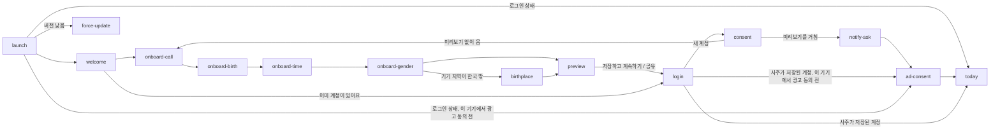
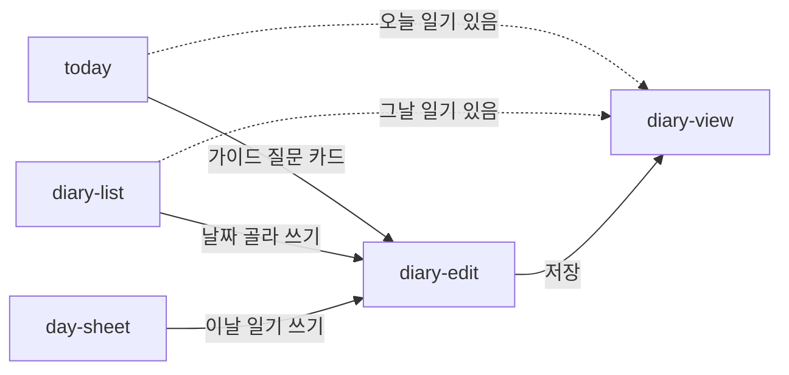
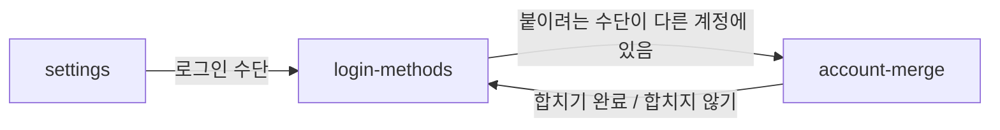

# MVP 화면 목록 (IA)

> 이 문서와 [`screens.json`](screens.json)의 내용이 다르면 **`screens.json`이 기준**입니다.

MVP 화면, 목적, 경로, 상태, 문장 슬롯, 컴포넌트를 정한 계약입니다(D39·D51). 설계 근거는 [IA spec](../specs/2026-10-11-ia-design.md)에 있습니다. 화면별 상세는 `screens.json`에서 봅니다.

## 탭 구조 (D48)

| 탭 | 첫 화면 | 맡는 일 |
| --- | --- | --- |
| 오늘 | `today` | 오늘 일진 풀이, 일기 쓰기 입구 |
| 달력 | `calendar` | 길흉과 일정. 일기와 1:1로 대응하지 않습니다 |
| 일기 | `diary-list` | 일기 보관함과 태그 모아보기 |
| 나 | `my-saju` | 나의 사주와 설정 |

## 시작과 로그인 (D50)

로그인 전에는 `welcome`, 온보딩 입력, `birthplace`, `calc-basis`(출생지 화면에서, D71), `preview`, `login`, `consent`, `legal`, `force-update`만 볼 수 있습니다. 첫 풀이를 먼저 보여주고 저장할 때 로그인을 받습니다.

## 일기 입구 세 곳 (D49)

일기는 하루 1편이고, 고른 날에 이미 일기가 있으면 보기로 갑니다.

## 로그인 수단과 계정 합치기 (D82)

한 계정에 카카오·LINE·Google·Apple을 여러 개 연결할 수 있습니다. 이메일로 계정을 잇지 않고, 사용자가 로그인 수단 화면에서 직접 붙입니다.

## 고치는 절차

* `screens.json`은 지휘 세션만 고칩니다. writing이나 design이 슬롯·컴포넌트를 새로 만들거나 빼야 하면 `to:root` Issue로 요청합니다.
* 슬롯 내용(목적, 문장 유형, 어미, 길이)은 writing이, 컴포넌트 생김새는 design이 정합니다. IA는 id, 자리, 한 줄 역할만 정합니다.
* **ui 문구를 IA 슬롯으로 둘지(D77):** 화면 제목, 그 화면에서 사용자가 읽는 문장(본문·안내·빈 상태·그 화면만의 오류·확인 창·결과 toast), 화면의 주 동작 버튼(저장·지우기 등, 출구가 되는 글자 버튼 포함), 모든 `content` 문장은 IA 슬롯입니다. 아이콘 버튼의 접근성 라벨, 컴포넌트 안의 작은 라벨, 글자 없는 틀(`#{tag}`, 날짜 서식), 여러 화면이 같이 쓰는 공통 낱말·오류 코드 문구는 IA 밖이고, writing이 `ui.*` 슬롯(W22)에 app ARB 키 이름으로 둡니다. app이 임시 문구를 writing에 요청하면 지휘가 이 기준으로 IA 슬롯감을 골라 IA에 더합니다.
* `app-bar`가 있는 화면은 app-bar 제목 자리로 `<화면 id>.bar.title` ui 슬롯을 둡니다. 화면의 `title` 필드는 문서용 한국어 이름이고, 화면에 보이는 제목은 이 슬롯의 원고입니다(#200).
* 화면의 `components`에는 그 화면의 내용 컴포넌트만 적습니다. 상태 컴포넌트(`skeleton`, `error-state`, `empty-state`, `notice-banner`)는 화면의 `states`에 따라 붙으며, 따로 적은 곳은 상태와 별개로 내용에 쓰는 경우입니다.
* 화면 id를 바꾸거나 지우거나, 슬롯·컴포넌트를 빼거나 id를 바꾸면 `version`을 올리고 app·writing·design·server에 `kind:request` Issue를 보냅니다(D78). 추가만 할 때는 올리지 않습니다.
* 형식 규칙은 spec §5에 있고, `python3 -I tools/docs-check/docs_check.py .`가 검사합니다.
