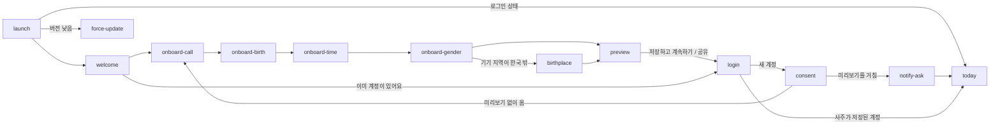
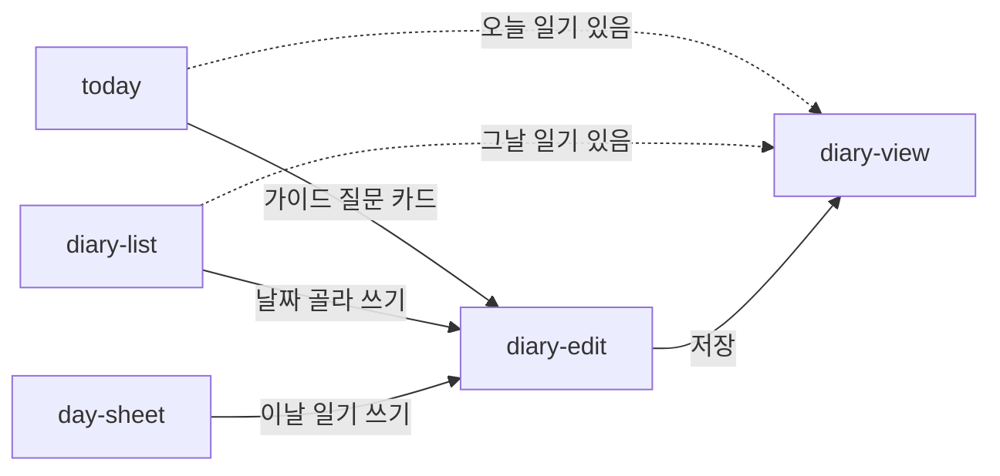

# MVP 화면 목록 (IA)

> 이 문서와 [`screens.json`](screens.json)의 내용이 다르면 **`screens.json`이 기준**입니다.

MVP 화면, 목적, 경로, 상태, 문장 슬롯, 컴포넌트를 정한 계약입니다(D39·D51). 설계 근거는 [IA spec](../specs/2026-10-11-ia-design.md)에 있습니다. 화면별 상세는 `screens.json`에서 봅니다.

## 탭 구조 (D48)

| 탭 | 첫 화면 | 맡는 일 |
| --- | --- | --- |
| 오늘 | `today` | 오늘 일진 풀이, 일기 쓰기 입구 |
| 달력 | `calendar` | 길흉과 일정. 일기와 1:1로 대응하지 않습니다 |
| 일기 | `diary-list` | 일기 보관함과 태그 모아보기 |
| 나 | `my-saju` | 나의 사주와 설정 |

## 시작과 로그인 (D50)

로그인 전에는 `welcome`, 온보딩 입력, `birthplace`, `preview`, `login`, `consent`, `legal`, `force-update`만 볼 수 있습니다. 첫 풀이를 먼저 보여주고 저장할 때 로그인을 받습니다.

## 일기 입구 세 곳 (D49)

일기는 하루 1편이고, 고른 날에 이미 일기가 있으면 보기로 갑니다.

## 고치는 절차

* `screens.json`은 지휘 세션만 고칩니다. writing이나 design이 슬롯·컴포넌트를 새로 만들거나 빼야 하면 `to:root` Issue로 요청합니다.
* 슬롯 내용(목적, 문장 유형, 어미, 길이)은 writing이, 컴포넌트 생김새는 design이 정합니다. IA는 id, 자리, 한 줄 역할만 정합니다.
* 화면 id를 바꾸거나 지우거나, 슬롯·컴포넌트를 빼면 `version`을 올리고 app·writing·design에 notice Issue를 보냅니다. 추가만 할 때는 올리지 않습니다.
* 형식 규칙은 spec §5에 있고, `python3 -I tools/docs-check/docs_check.py .`가 검사합니다.
