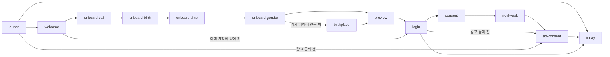

# MVP 화면 목록(IA) — 설계

* 작성: 지휘 세션, 2026-10-11
* 상태: 검토 대기
* 관련 결정: D39(이 작업의 근거), D47~D51(이 spec에서 정함)
* 받는 쪽: app(A1 화면 흐름·상태 관리), writing(W0 슬롯 목록), design(V2 컴포넌트), server(S1 범위)

## 1. 목적

1. **MVP 화면을 하나의 계약으로 고정합니다.** 화면, 목적, 들어가고 나가는 경로, 상태, 펼칠 수 있는 깊이, 문장 슬롯, 컴포넌트를 `docs/ia/screens.json` 한 파일에 둡니다.
2. **네 세션이 같은 id를 씁니다.** app은 화면 id로 라우팅을 짜고, writing은 슬롯 id로 문장을 쓰고, design은 컴포넌트 id로 시스템을 만들고, server는 `content` 슬롯으로 템플릿 범위를 압니다.
3. **지휘 세션 미결을 닫습니다.** 해시태그 회고와 오프라인 동기화의 MVP 포함 여부를 여기서 정합니다(§2).
4. **제품 지도의 뼈대가 됩니다.** 제품 지도(D45)는 임시 화면 목록 대신 이 파일을 읽습니다.

## 2. 범위 결정

| 항목 | 결정 | 근거 |
| --- | --- | --- |
| 해시태그 회고 | **최소형 포함.** 태그 칩을 누르면 같은 태그가 붙은 일기 목록이 열립니다. 통계는 Phase 2입니다 | 칩이 반응하지 않는 장식이 되지 않게 합니다(00 §3.4, 06 §4) |
| 오프라인 | **로컬 초안만.** 저장은 온라인에서만 합니다. 작성 중인 글은 기기에 초안으로 남고 연결되면 저장합니다. 동기화·충돌 처리는 Phase 2입니다 | 글을 잃지 않는 것이 핵심이고, 동기화는 server·app 양쪽이 크게 복잡해집니다(02 §2.2) |
| 일정 | **기본 일정 포함.** 제목, 날짜, 종일 또는 시간, 메모. 일정을 넣을 때 그날 성격을 한 줄 보여줍니다. 반복·일정 알림·외부 캘린더 연동은 2차입니다 | 길흉을 실제로 쓰려면 달력에 일정이 있어야 합니다. 04 §4.4를 개정합니다 |
| 공유 | **오늘 카드 이미지 공유 포함, 로그인 필요.** 미리보기에도 공유 버튼을 두고, 누르면 로그인 후 공유할 수 있다고 알린 뒤 로그인으로 잇습니다. 일기는 공유하지 않습니다 | 자연 유입 경로. 이미지는 앱에서 만듭니다(V5) |
| 출생지 | **포함.** 기기 지역이 한국이 아닐 때(온보딩)와 언어를 바꿀 때(설정) 도시 단위 출생지 입력을 안내합니다 | D29. 영어·일본어 지원(D28)으로 출시 때부터 해당 사용자가 생깁니다 |
| 다른 날 전체 풀이 | **제외.** 달력에서는 그날 성격 한 줄만 보여줍니다 | 미래 날짜 전체 풀이를 그때그때 계산하면 server 부담이 커집니다(D31 배치는 다음 날까지) |

## 3. 구조

### 3.1 탭 (D48)

| 탭 id | 이름 | 첫 화면 | 맡는 일 |
| --- | --- | --- | --- |
| `today` | 오늘 | `today` | 오늘 일진 풀이, 일기 쓰기 입구 |
| `calendar` | 달력 | `calendar` | 길흉과 일정. 일기와 1:1로 대응하지 않습니다 |
| `diary` | 일기 | `diary-list` | 일기 보관함과 태그 모아보기 |
| `me` | 나 | `my-saju` | 나의 사주와 설정 |

### 3.2 일기 (D49)

* 하루에 여러 편 쓸 수 있습니다(D83, D49 개정). 지난 날도 새로 쓸 수 있고 미래 날짜는 쓸 수 없습니다. 같은 날 일기는 그날 일진·가이드 질문·태그를 함께 쓰고 작성 순으로 보입니다. 한 날짜에 살아 있는 일기는 10편까지입니다(D83 ②). 10편을 채운 날의 쓰는 입구 세 곳은 누를 수 없고 더 쓸 수 없다고 알립니다. 다른 기기나 오프라인 초안 때문에 저장·되살리기가 상한에 걸리면 오류 문구로 알리고 초안은 기기에 남깁니다.
* 가이드 질문과 해시태그는 **그 일기의 날짜** 일진으로 정합니다.
* 쓰는 입구는 세 곳이고 모두 `diary-edit`로 이어집니다: `today`의 가이드 질문 카드, `diary-list`의 날짜 골라 쓰기, `day-sheet`의 이날 일기 쓰기. 입구는 언제나 새 일기를 엽니다(D83). 이미 쓴 일기는 `today`·`day-sheet`의 일기 줄과 `diary-list`에서 `diary-view`로 엽니다.

### 3.3 로그인 (D50)

* 로그인 전에 볼 수 있는 화면은 `welcome`, 온보딩 입력, `birthplace`, `calc-basis`(출생지 화면에서, D71), `preview`, `login`, `consent`, `legal`, `force-update`뿐입니다.
* `preview`는 로그인 없이 한 번 계산합니다. server는 이를 위한 미리보기 요청 하나를 둡니다(입력을 저장하지 않음).
* 로그인 뒤 갈래:
  * 새 계정: `consent` → (미리보기를 거쳤으면) 입력값 저장 → `notify-ask` → `ad-consent` → `today`. 미리보기 없이 '이미 계정이 있어요'로 왔으면 `consent` → `onboard-call`.
  * 사주가 저장된 계정: 미리보기 입력이 있으면 그 입력을 쓰지 않는다고 알린 뒤 `today`. 없으면 바로 `today`.
* 광고 동의(D53): 이 기기에서 처음 광고를 보이기 전에 `ad-consent`를 한 번 거칩니다. 새 계정은 `notify-ask` 뒤, 기존 계정은 로그인하거나 앱을 열 때 이 기기에서 동의를 받지 않았으면 `today` 전에 거칩니다.
* 로그아웃: `settings`에서 확인 창을 거쳐 `welcome`.
* 로그아웃 상태에서 아침 알림을 누르면 `welcome`.

### 3.4 주요 흐름



## 4. 화면 목록

`presentation`·`auth`·상태 값은 §5.2의 목록을 따릅니다. "나가는 경로"는 `exits`입니다. 모든 탭 첫 화면은 `tab-bar`로 서로 오가며, 이 경로는 표에 적지 않습니다.

### 4.1 시작과 온보딩 (탭 없음)

| id | 이름 | 표시·인증 | 목적 | 나가는 경로 | 상태 |
| --- | --- | --- | --- | --- | --- |
| `launch` | 앱 시작 | page·any | 로그인 상태와 앱 버전을 확인합니다 | `today`(로그인), `welcome`(로그아웃), `force-update`(버전 낮음) | loading, offline |
| `force-update` | 업데이트 필요 | page·any | 규칙 버전이나 API가 바뀌어 옛 앱을 막습니다 | 스토어(외부) | — |
| `welcome` | 시작 | page·guest | 컨셉을 한 화면으로 보여줍니다 | `onboard-call`(시작하기), `login`(이미 계정이 있어요) | — |
| `onboard-call` | 호칭 | page·any | 앱이 부를 말을 받습니다. 필수이고 실명이 아니어도 됩니다(D36) | `onboard-birth`, `profile-edit`(정보 수정에서 온 경우) | — |
| `onboard-birth` | 생일 | page·any | 양력·음력, 윤달을 받습니다(D18 ①). 한국 출생 기준임을 표시합니다(D29) | `onboard-time`, `profile-edit`(정보 수정에서 온 경우) | out-of-range |
| `onboard-time` | 태어난 시간 | page·any | 시간을 받고 '모름'을 고를 수 있습니다(D18 ②) | `onboard-gender`, `profile-edit`(정보 수정에서 온 경우) | time-unknown |
| `onboard-gender` | 성별 | page·any | 대운 방향 계산에 씁니다(D18 ③) | `preview`, `birthplace`(기기 지역이 한국 밖), `notify-ask`(로그인한 새 계정, D68), `profile-edit`(정보 수정에서 온 경우) | — |
| `birthplace` | 출생지 | page·any | 도시를 검색해 시간대와 경도를 정합니다(D29). 한국 표준 기준으로 계산한다는 소개를 함께 둡니다(D71) | `preview`, `notify-ask`(로그인한 새 계정, D68), `profile-edit`(정보 수정에서 온 경우), `settings`(언어 변경 안내에서 온 경우), `calc-basis`(계산 기준 보기, D71) | loading, empty, error |
| `preview` | 첫 풀이 | page·guest | 오늘 풀이 일부를 로그인 없이 보여줍니다 | `login`(저장하고 계속하기), `login`(공유 → 로그인 안내 창), `onboard-call`(다시 입력) | loading, error, offline, time-unknown |
| `login` | 로그인 | page·guest | 소셜 로그인(카카오·LINE·Google·Apple, D82. 언어마다 맨 위 제공자만 다름) | `consent`(새 계정), `today`(기존 계정) | error |
| `consent` | 약관 동의 | page·member | 필수 약관과 개인정보 수집 동의를 받습니다. 선택 동의는 없습니다(D67) | `notify-ask`(미리보기를 거친 새 계정), `onboard-call`(그 외 새 계정), `legal` | error |
| `notify-ask` | 알림 허락 | page·member | 아침 운세 알림 시각과 권한을 받습니다(D18 ⑨). 건너뛸 수 있습니다 | `ad-consent` | — |
| `system-push` | 아침 알림 | system·member | 아침 운세 알림(OS 알림). 그날 데일리로 개인화하고, 잠금 화면에 보이므로 호칭을 넣지 않습니다(D62) | `today`(알림 누름) | — |
| `system-apple-return` | Apple 로그인 복귀 안내 | system·any | Android Apple 웹 로그인 뒤 App Link가 앱을 열지 못할 때 server가 브라우저에 내주는 페이지(server S22). 앱에서 계속하도록 안내합니다. 문구는 server가 렌더하는 content 슬롯이고 호칭이 없습니다(D66) | `welcome`(앱에서 열기) | — |
| `ad-consent` | 광고 동의 | system·member | iOS 추적 허용(ATT)과 필요한 지역의 광고 동의(UMP). 이 기기에서 처음 광고를 보이기 전 한 번, 거절해도 비맞춤 광고로 계속(D53) | `today` | — |

`onboard-*`와 `birthplace`는 온보딩과 `profile-edit`가 함께 씁니다. 그래서 `auth`가 any이고, 정보 수정에서 열렸으면 저장 뒤 `profile-edit`로 돌아갑니다.

### 4.2 오늘 탭

| id | 이름 | 표시·인증 | 목적 | 나가는 경로 | 상태 |
| --- | --- | --- | --- | --- | --- |
| `today` | 오늘 | page·member | 오늘 일진을 내 원국에 맞춰 풀고 일기로 잇습니다. 날의 성격, 총운(좋아요 반응, D40), 행운 카드 4종(색·방향·숫자·집중 시간), 오늘 일정 한 줄, 가이드 질문 카드, 공유 | `diary-edit`(가이드 질문 카드, 새 일기), `diary-view`(오늘 쓴 일기 줄, D83), `explain-sheet`, `evidence-sheet`, `share-preview`, `day-sheet`(오늘 일정 한 줄) | loading, error, offline, time-unknown |
| `explain-sheet` | 풀이 시트 | half-sheet·member | `explain` 깊이. 용어 뜻과 오늘 그런 이유. 모든 화면이 함께 씁니다 | `evidence-sheet` | loading, error |
| `evidence-sheet` | 근거 시트 | full-sheet·member | `evidence` 깊이. 판정 근거와 원전, 원국 개인 해석("내 사주에서는"). 권한이 없으면 잠금 안내(D60). 모든 화면이 함께 씁니다 | `system-rewarded-ad`(광고 보고 열기), `ad-free` | loading, error |
| `share-preview` | 공유 미리보기 | half-sheet·member | 공유 이미지(라이트 고정, V5)를 미리 보고 기기 공유 시트로 넘깁니다 | `system-share` | — |
| `system-share` | 기기 공유 | system·member | OS 공유 시트 | — | — |

### 4.3 달력 탭

| id | 이름 | 표시·인증 | 목적 | 나가는 경로 | 상태 |
| --- | --- | --- | --- | --- | --- |
| `calendar` | 달력 | page·member | 한 달 단위 길흉(날짜 칸 채우기, design 결정 V10), 음력 날짜·절기(D18 ⑧), 일정 표시 | `day-sheet`(날짜), `event-edit`(일정 추가) | loading, error, offline |
| `day-sheet` | 그날 시트 | half-sheet·member | 날의 성격 한 줄, 그날 일정, 일정 추가, 그날 쓴 일기 줄(작성 순)과 이날 일기 쓰기(지난 날·오늘, 언제나 새 일기, D83) | `event-edit`, `diary-view`, `diary-edit`, `explain-sheet` | loading, empty, error |
| `event-edit` | 일정 편집 | page·member | 일정 추가·수정·삭제. 제목, 날짜, 종일 또는 시간, 메모. 그날 성격 한 줄을 보여줍니다. 일정 보기 화면을 겸합니다 | 이전 화면으로 복귀 | loading, error, offline |

### 4.4 일기 탭

| id | 이름 | 표시·인증 | 목적 | 나가는 경로 | 상태 |
| --- | --- | --- | --- | --- | --- |
| `diary-list` | 일기 목록 | page·member | 시간순 목록(같은 날 여러 편은 작성 순, D83), 날짜 골라 새 일기 쓰기(미래 날짜는 고를 수 없음) | `diary-view`, `diary-edit`, `tag-diary` | loading, empty, error, offline |
| `diary-edit` | 일기 쓰기 | page·member | 가이드 질문, 본문, 로컬 초안. 저장하면 태그가 붙습니다 | `diary-view`(저장) | loading, error, offline, draft |
| `diary-view` | 일기 보기 | page·member | 일기 한 편의 본문, 그날 성격, 태그 칩, 고치기·지우기 | `diary-edit`(고치기), `tag-diary`, `explain-sheet` | loading, error |
| `tag-diary` | 태그 모아보기 | page·member | 같은 태그가 붙은 일기 목록과 태그 뜻 한 줄 | `diary-view`, `explain-sheet` | loading, empty, error |

### 4.5 나 탭

| id | 이름 | 표시·인증 | 목적 | 나가는 경로 | 상태 |
| --- | --- | --- | --- | --- | --- |
| `my-saju` | 나의 사주 | page·member | `surface`: 일간 소개, 용신·행운 색(D16) | `saju-chart`(근거 보기), `explain-sheet`, `settings`(상단 톱니) | loading, error, time-unknown |
| `saju-chart` | 사주 표 | page·member | `evidence`: 원국표·오행 분포·용신 판정 근거 / 만세력 기본 표(D18 ⑥)·대운·세운 표(D18 ⑦) 두 탭 | `explain-sheet` | loading, error, time-unknown |
| `settings` | 설정 | page·member | 알림 시각, 광고 제거, 언어(바꾸면 출생지 안내), 정보 수정, 계산 기준, 로그인 수단(D82), 로그아웃, 계정 삭제, 약관(기본 깊이는 D79로 삭제). 알림 시각·언어는 설정 안에서 고르거나 하프 시트로 고릅니다 | `ad-free`, `profile-edit`, `birthplace`(언어 변경 안내), `calc-basis`, `login-methods`, `account-delete`, `legal`, `welcome`(로그아웃) | — |
| `profile-edit` | 정보 수정 | page·member | 호칭, 생일, 시간, 성별, 출생지를 고칩니다. 바꾸면 풀이가 다시 계산된다고 알립니다. 호칭 말고 다른 값을 바꿔 저장하면 확인 창을 띄웁니다 | `onboard-call`, `onboard-birth`, `onboard-time`, `onboard-gender`, `birthplace` | error |
| `ad-free` | 광고 제거 | page·member | 1개월 광고 제거권(자동 갱신 없음)을 사고, 남은 기간을 보고, 구매를 복원합니다(D53) | `system-purchase`(구매), `legal` | loading, error, offline |
| `system-purchase` | 스토어 결제 | system·member | OS 결제 시트(App Store·Google Play) | `ad-free` | — |
| `system-rewarded-ad` | 보상형 광고 | system·member | AdMob 보상형 광고 전면 재생. 끝까지 보면 server 확인(SSV) 뒤 오늘 자정까지 근거·해석이 열림(D60) | `evidence-sheet` | — |
| `calc-basis` | 계산 기준 | page·any | 여러 유파 가운데 한국 표준으로 해석(D28·D71), 다른 유파와 다른 점, 출생 시간대 기준 경도 보정(D42·D71), 음력 기준(D41). 출생지 화면에서 로그인 전에도 엽니다 | — | — |
| `login-methods` | 로그인 수단 | page·member | 이 계정에 연결한 인증 수단을 보여주고 다른 제공자를 붙이거나 뗍니다. 마지막 하나는 뗄 수 없고, 다른 계정에 연결된 인증 수단은 붙이지 않습니다(D82 ⑤, D85 ③) | `account-merge`(계정 합치기) | error |
| `account-merge` | 계정 합치기 | page·member | 합칠 계정의 인증 수단으로 인증해 그 계정의 기록을 이 계정으로 가져오고 그 계정을 지웁니다. 인증 수단은 가져오지 않고, 사주 정보·호칭·설정은 고른 쪽을 남기며, 같은 날 일기도 모두 옮깁니다(D85 ④, D83 ④) | `login-methods`(완료·취소) | loading, error |
| `account-delete` | 계정 삭제 | page·member | 지워지는 데이터를 안내하고 최종 확인을 받습니다(스토어 요건) | `welcome`(삭제 완료) | error |
| `legal` | 약관·정책 | page·any | 이용약관, 개인정보 처리방침, 오픈소스 라이선스 | — | — |

## 5. 계약 형식 `docs/ia/screens.json` (D51)

### 5.1 모양

```json
{
  "version": 1,
  "tabs": [{"id": "today", "title": "오늘", "root": "today"}],
  "components": [{"id": "lucky-card", "role": "행운 항목 하나(색·방향·숫자·시간)"}],
  "screens": [
    {
      "id": "today",
      "title": "오늘",
      "tab": "today",
      "presentation": "page",
      "auth": "member",
      "purpose": "오늘 일진을 내 원국에 맞춰 풀어 보여주고 일기로 이어줍니다",
      "depths": ["surface", "explain", "evidence"],
      "states": [{"id": "loading", "note": "카드 자리 스켈레톤"}],
      "slots": [{"id": "today.fortune.head", "source": "content", "role": "총운 첫 문장, 호칭 자리"}],
      "components": ["day-character", "lucky-card"],
      "exits": [{"to": "diary-edit", "trigger": "가이드 질문 카드 누름"}],
      "decisions": ["D13", "D19", "D40"]
    }
  ]
}
```

### 5.2 필드 규칙

| 필드 | 필수 | 값 |
| --- | --- | --- |
| `version` | 예 | 1부터 시작하는 정수 |
| `tabs[].id`·`title`·`root` | 예 | `root`는 있는 화면 id |
| `components[].id`·`role` | 예 | 소문자·숫자·하이픈 |
| `screens[].id` | 예 | 소문자·숫자·하이픈, 유일 |
| `title`, `purpose` | 예 | 비어 있지 않은 문자열 |
| `tab` | 예 | 탭 id 또는 `null`(탭에 속하지 않음) |
| `presentation` | 예 | `page`, `half-sheet`, `full-sheet`, `system` |
| `auth` | 예 | `guest`(로그인 전 전용), `member`(로그인 필요), `any` |
| `depths` | 예 | `surface`, `explain`, `evidence`의 부분집합(빈 목록 가능, D37) |
| `states[].id` | 예 | `loading`, `empty`, `error`, `offline`, `draft`, `time-unknown`, `out-of-range`. 화면마다 다른 내용은 `note`에 적습니다 |
| `slots[].id` | 예 | `<화면 id>.<영역>.<부분>`(점으로 나눈 세 마디 이상, 각 마디는 소문자·숫자·하이픈). 저장소 전체에서 유일 |
| `slots[].source` | 예 | `content`(server 템플릿이 엔진 판정값으로 만드는 문장, D27) 또는 `ui`(앱 다국어 리소스의 고정 문구) |
| `slots[].role` | 예 | 한 줄 역할. 호칭을 부르는 자리는 "호칭 자리"를 넣고, 화면마다 많아야 한 곳입니다(D36) |
| `screens[].components` | 예 | 맨 위 `components`에 있는 id만 |
| `exits[].to`·`trigger` | 예 | `to`는 있는 화면 id. 들어오는 경로는 적지 않습니다(다른 화면의 `exits`를 모으면 나옴). 앱 밖(스토어 등)은 `trigger`에만 적고 `exits`에 넣지 않습니다 |
| `decisions` | 예 | 결정 로그(`docs/decisions.md`, 서브 프로젝트·작업 단위 로그)에 있는 ID |

### 5.3 소유 경계

* IA는 슬롯과 컴포넌트의 **id, 자리, 한 줄 역할**만 정합니다.
* 슬롯의 목적, 문장 유형(D40), 어미, 길이, 예시는 writing의 슬롯 파일이 정합니다. writing 스키마의 `where`는 슬롯 id 앞부분의 화면 id입니다.
* 컴포넌트의 변형, 토큰, 상태별 생김새는 design이 정합니다.
* writing이나 design이 슬롯·컴포넌트를 새로 만들거나 빼야 하면 `to:root` Issue로 요청하고, 지휘 세션이 IA에 반영합니다.

### 5.4 버전

* 화면 id를 바꾸거나 지우거나, 슬롯·컴포넌트를 빼거나 id를 바꾸면 `version`을 올리고 app·writing·design에 notice Issue를 보냅니다.
* 화면·슬롯·컴포넌트·경로·상태를 추가만 할 때는 올리지 않습니다.

### 5.5 사람이 읽는 문서 `docs/ia/README.md`

* 첫 줄에 "내용이 `screens.json`과 다르면 JSON이 기준"이라고 적습니다.
* 탭 구조(§3.1), 로그인 갈래(§3.3), 주요 흐름(§3.4)과 일기 입구 세 곳을 mermaid로 그립니다.
* 화면별 상세는 JSON으로 미룹니다(중복 방지).

## 6. 컴포넌트 목록

| 묶음 | id | 역할 |
| --- | --- | --- |
| 골격 | `tab-bar` | 탭 4개 |
| | `app-bar` | 화면 제목·뒤로·동작 아이콘 |
| | `sheet` | 하프·풀 시트 틀 |
| | `dialog` | 확인 창 |
| | `toast` | 짧은 알림 |
| | `notice-banner` | 오프라인·시간 모름 같은 화면 위 안내 |
| | `skeleton` | 불러오는 중 자리 |
| | `empty-state` | 비어 있을 때 |
| | `error-state` | 오류일 때(다시 시도) |
| 문장·깊이 | `sentence-block` | 콘텐츠 문장 덩어리 |
| | `term-token` | 명리 용어 표시(V3). 누르면 풀이 시트 |
| | `depth-link` | 한 단계 깊이로 가는 링크("근거 보기") |
| | `reaction-button` | 문장 반응(좋아요, D40) |
| 오늘 | `day-character` | 날의 성격 배지와 한 줄(D19·D20) |
| | `lucky-card` | 행운 항목 하나(색·방향·숫자·시간 변형) |
| | `guide-question-card` | 가이드 질문과 쓰기 입구 |
| | `share-button` | 공유 |
| | `share-image` | 공유 이미지 틀(라이트 고정, V5) |
| 입력 | `input-step` | 질문 하나짜리 입력 화면 틀 |
| | `text-field` | 글자 입력 |
| | `date-picker` | 날짜(양력·음력, 윤달) |
| | `time-picker` | 시간('모름' 포함) |
| | `segmented` | 몇 개 중 하나 고르기 |
| | `check-row` | 동의 항목 한 줄 |
| | `city-search` | 도시 검색과 결과 목록 |
| | `social-login-button` | 소셜 로그인 버튼 |
| | `primary-button` | 주 동작 버튼 |
| 달력 | `calendar-month` | 한 달 격자 |
| | `day-cell` | 날짜 칸(길흉 칸 채우기·음력·절기·일정 표시) |
| | `event-row` | 일정 한 줄 |
| 일기 | `diary-row` | 일기 목록 한 줄 |
| | `diary-editor` | 본문 입력 |
| | `draft-indicator` | 초안 저장 상태 |
| | `tag-chip` | 해시태그 칩(누르면 태그 모아보기) |
| 사주 | `saju-pillars` | 원국표 |
| | `ohaeng-bar` | 오행 분포 |
| | `manse-table` | 만세력 기본 표(십성·지장간·12운성·신살) |
| | `daeun-table` | 대운·세운 표 |
| 설정 | `settings-row` | 설정 한 줄 |
| 수익(D53) | `ad-banner` | 탭 루트 하단 적응형 배너 광고 자리. 광고 제거 기간에는 숨김 |
| | `offer-card` | 광고 제거권 상품 설명·가격·기간 카드 |

## 7. 화면별 슬롯과 컴포넌트

슬롯은 화면 id를 줄여 적습니다. 실제 id는 `today.fortune.head`처럼 화면 id부터 씁니다. **굵은 슬롯**은 `source: content`, 나머지는 `ui`입니다. 탭 첫 화면에는 `tab-bar`, 나머지 page에는 `app-bar`가 붙으며 표에서는 생략합니다. 탭 첫 화면 4곳(`today`·`calendar`·`diary-list`·`my-saju`)에는 `ad-banner`도 붙습니다(D53).

| 화면 | 슬롯 | 컴포넌트 |
| --- | --- | --- |
| `launch` | (없음) | skeleton |
| `force-update` | `notice.head`, `notice.body`, `cta.store` | primary-button |
| `welcome` | `concept.head`, `concept.body`, `cta.start`, `cta.signin` | primary-button |
| `onboard-call` | `question.head`, `input.hint`, `note.body`(실명이 아니어도 됨) | input-step, text-field, primary-button |
| `onboard-birth` | `question.head`, `calendar.hint`(음력·윤달), `basis.note`(한국 출생 기준), `error.range`(지원 범위 밖, D41) | input-step, date-picker, primary-button |
| `onboard-time` | `question.head`, `unknown.note`(3주로 계산), `hour.confirm`(ui 틀, D68) | input-step, time-picker, primary-button |
| `onboard-gender` | `question.head`, `why.body`(대운 방향) | input-step, segmented, primary-button |
| `birthplace` | `question.head`, `why.body`, `standard.note`·`standard.link`(D71), `search.hint`, `empty.body` | input-step, city-search, empty-state, depth-link(`navigate` 변형, design 요청) |
| `preview` | **`character.label`**, **`fortune.head`**(호칭 자리), **`fortune.body`**, `cta.save`, `cta.restart`, `restart.notice`(D86 ⑤), `share.login-notice` | day-character, sentence-block, share-button, primary-button, dialog |
| `login` | `title.head`, `title.body`, `discard.notice` | social-login-button, dialog |
| `consent` | `title.head`, `required.label`, `cta.agree` | check-row, primary-button |
| `notify-ask` | `question.head`, `why.body`, `cta.allow`, `cta.skip` | input-step, time-picker, primary-button |
| `system-push` | **`morning.body`** | (없음) |
| `system-apple-return` | **`page.title`**, **`page.body`**, **`page.open`**, **`page.install`** | (없음) |
| `ad-consent` | (없음) | (없음) |
| `today` | **`character.label`**, **`character.reason`**, **`fortune.head`**(호칭 자리), **`fortune.body`**, **`lucky-color.body`**, **`lucky-direction.body`**, **`lucky-number.body`**, **`lucky-time.body`**, **`guide.question`**, `guide.cta`, `event.summary`, `reaction.label` | day-character, sentence-block, term-token, reaction-button, lucky-card, guide-question-card, event-row, share-button, depth-link |
| `explain-sheet` | **`term.meaning`**, **`today.reason`** | sheet, sentence-block, depth-link |
| `evidence-sheet` | **`basis.body`**, **`source.quote`**, **`personal.body`**, `lock.head`, `lock.reward`, `lock.cta`, `lock.pass`, `lock.unavailable`, `section.basis`, `section.source`, `section.personal`, `unlock.failed`, `a11y.locked`, `a11y.checking`, `a11y.unlocked` | sheet, sentence-block, saju-pillars, primary-button, toast |
| `share-preview` | `image.footer`, `cta.share` | sheet, share-image, primary-button |
| `system-share` | (없음) | (없음) |
| `calendar` | `legend.body`(점 색의 뜻) | calendar-month, day-cell |
| `day-sheet` | **`character.label`**, **`character.reason`**, `event.empty`, `event.add`, `diary.open`, `diary.write-cta` | sheet, day-character, event-row, diary-row, term-token |
| `event-edit` | **`character.hint`**(그날 성격 한 줄), `title.hint`, `memo.hint`, `delete.confirm` | text-field, date-picker, time-picker, segmented, primary-button, dialog |
| `diary-list` | `empty.body`, `pick-date.cta` | diary-row, tag-chip, date-picker, empty-state |
| `diary-edit` | **`guide.question`**, `body.placeholder`, `draft.status`, `offline.notice`, `saved.tags` | sentence-block, diary-editor, draft-indicator, notice-banner, toast, primary-button |
| `diary-view` | **`character.label`**, `delete.confirm` | day-character, sentence-block, tag-chip, dialog |
| `tag-diary` | **`tag.meaning`**, `empty.body` | sentence-block, term-token, diary-row, empty-state |
| `my-saju` | **`ilgan.head`**(호칭 자리), **`ilgan.body`**, **`yongsin.body`** | sentence-block, term-token, lucky-card, depth-link |
| `saju-chart` | **`yongsin.basis`**, `yongsin.open`, `yongsin.title`, `time-unknown.notice` | saju-pillars, ohaeng-bar, manse-table, daeun-table, term-token, notice-banner, segmented, sentence-block |
| `settings` | `language.birthplace-notice`, `logout.confirm`, `ad-free.label` | settings-row, time-picker, dialog |
| `ad-free` | `offer.head`, `offer.price`, `status.remaining`, `restore.cta`, `restore.notice`(D86 ④), `legal.notice` | offer-card, primary-button |
| `system-purchase` | (없음) | (없음) |
| `system-rewarded-ad` | (없음) | (없음) |
| `profile-edit` | `recalc.notice`, `recalc.confirm` | settings-row, notice-banner, dialog |
| `calc-basis` | `convention.body`(D28·D71), `schools.body`(D71), `longitude.body`(D42·D71, 출생 시간대별 값), `lunar.body`(D41), `daeun.body`(core C5, D86 ⑦) | (없음, 일반 글자) |
| `login-methods` | `intro.body`, `last.notice`, `unlink.confirm`, `in-use.body`, `merge.cta`, `error.body` | social-login-button, dialog |
| `account-merge` | `title.head`, `auth.body`, `not-other.body`, `title.body`, `choice.label`, `overlap.notice`, `cta.merge`, `cta.cancel`, `merge.confirm` | social-login-button, account-choice, primary-button, dialog |
| `account-delete` | `title.head`, `data.body`, `cta.delete`, `delete.confirm` | primary-button, dialog |
| `legal` | (없음) | settings-row |

판단을 내린 곳:
* `today.event.summary`는 `ui`입니다. 일정은 사용자 데이터라 고정 문구에 값만 넣습니다.
* `tag-diary.tag.meaning`은 `content`입니다. 태그 뜻은 server 템플릿이 만듭니다.
* `calc-basis`는 모두 `ui`입니다. 날마다 바뀌지 않는 고정 안내입니다.

## 8. 함께 바꾸는 것

* `docs/decisions.md`: D47~D51 추가.
  * D47: MVP 범위(§2의 해시태그·오프라인·일정·공유·출생지·다른 날 전체 풀이). 04 §4.4 개정.
  * D48: 탭 4개(§3.1).
  * D49: 일기 하루 1편, 지난 날 쓰기, 미래 불가(§3.2). → D83으로 개정: 하루 여러 편.
  * D50: 로그인은 첫 풀이 뒤, 미리보기 요청(§3.3).
  * D51: IA 계약 형식·소유 경계·버전(§5).
* `docs/roadmap.md`: 마일스톤 IA 완료, 지휘 미결의 해시태그·오프라인·화면 목록 줄 삭제, 현재 진행 순서 갱신(A1 시작 가능).
  * 개정(D52, 2026-10-11): A1·S1 착수는 수익화 사이클 M0 뒤로 미룹니다. M0 완료(D53)로 해제했습니다.
* `docs/contracts/README.md`: IA 계약 한 줄 추가.
* `tools/docs-check`: IA 검사 추가(§9).
* `tools/product-map/build_map_data.py`: `collect_screens`가 객체의 `screens`를 읽습니다. 임시 목록은 파일이 없을 때만 씁니다.

## 9. 검사

`tools/docs-check/docs_check.py`에 IA 검사를 넣고, `docs/ia/screens.json`이 있으면 검사합니다. 테스트를 먼저 씁니다.

1. JSON으로 읽히고 맨 위가 `version`·`tabs`·`components`·`screens`를 가진 객체인지
2. §5.2의 필수 필드와 허용 값
3. 화면·컴포넌트·슬롯 id 중복
4. `tabs[].root`, `screens[].tab`, `exits[].to`가 있는 대상인지
5. 슬롯 id가 자기 화면 id로 시작하는지
6. `screens[].components`가 목록 안에 있는지
7. `decisions`의 ID가 결정 로그에 있는지
8. 화면마다 "호칭 자리"가 많아야 한 곳인지

제품 지도 테스트에는 객체 형식 읽기를 추가합니다.

## 10. 넘겨주기 (병합 뒤 notice Issue)

개정(D52, 2026-10-11): app·server notice는 수익화 사이클 M0가 끝난 뒤 보냅니다. writing·design notice는 병합 직후 보냅니다.

개정(D53, 2026-10-11): M0 결과로 화면 `ad-consent`·`ad-free`·`system-purchase`, 컴포넌트 `ad-banner`·`offer-card`, 슬롯 6개를 더했습니다(추가만이라 v1 유지). §3.3·§3.4·§4·§6·§7 본문에 반영했고, 아래 표의 범위에 광고와 광고 제거권을 더합니다.

| 받는 쪽 | 마일스톤 | 내용 |
| --- | --- | --- |
| app | A1 | A1 설계를 시작할 수 있습니다. 화면·상태·경로·인증 갈래(§3.3)·로컬 초안을 받습니다. D53: AdMob 배너(탭 루트 4곳), ATT·UMP 동의, 광고 제거권 인앱결제(RevenueCat 기본안)와 구매 복원 |
| writing | W0 | 슬롯 목록과 `source` 구분을 받습니다. 슬롯 `where`는 IA 화면 id입니다. 새 슬롯이 필요하면 `to:root` Issue로 요청합니다 |
| design | V2 | 컴포넌트 목록(§6)을 받습니다. D53: `ad-banner`·`offer-card` |
| server | S1 | 범위가 늘어납니다: 일정 CRUD, 로그인 없는 미리보기 요청, 태그별 일기 조회, 일기 하루 1편 제약(날짜 유일), 도시 목록(시간대·경도), 계정 삭제, 최소 앱 버전 응답. D53: 만료일이 있는 entitlement 모델(구독으로 넓혀 쓸 수 있게), 영수증 검증(RevenueCat webhook 기본안), 광고 제거 여부 응답 |

개정(D60, 2026-10-11): evidence 깊이의 해석(판정 근거·원전·원국 개인 해석)을 잠긴 기능으로 두고 보상형 광고·광고 제거권으로 엽니다. 화면 `system-rewarded-ad`, `evidence-sheet` 슬롯 6개와 출구를 더했습니다(추가만이라 v1 유지). 잠김은 화면 상태 값이 아니라 슬롯으로 나타냅니다.

개정(2026-10-13, Issue #64·#48): 컴포넌트 명세 2.0.0(근거 깊이 잠금)을 그리는 데 필요한 것을 더했습니다. `evidence-sheet`에 구역 제목·해제 실패 toast·접근성 문구 ui 슬롯 7개와 컴포넌트 `toast`, `saju-chart`에 `yongsin.open`과 컴포넌트 `sentence-block`. 아침 알림 문장을 위해 시스템 화면 `system-push`와 content 슬롯 `system-push.morning.body`(호칭 없음, D62)를 더했습니다. 추가만이라 v1 유지입니다.

개정(2026-10-20, D77, Issue #275): ui 문구를 IA 슬롯으로 둘지의 기준을 정했습니다(README "고치는 절차"). 이 기준으로 `diary-edit.save.cta`, `diary-view.deleted.toast`, `event-edit.save.cta`·`delete.cta`·`offline.notice`·`save.failed`, `login.error.body`, `evidence-sheet.sheet.title`, `today.evidence.link`(모두 ui)를 더했습니다. 뒤의 일곱(event-edit 넷·login·evidence-sheet·today)은 writing `ui.*`(W22)에 있던 화면 문구를 옮긴 것이고 ARB 키 이름은 그대로입니다. 추가만이라 v3 유지입니다.

개정(2026-10-15, v3, D71): 한국 기준을 한국에서 보편적으로 쓰는 해석이자 여러 유파 가운데 근거 있는 하나로 소개합니다(우열 비교 없음). `birthplace`에 `standard.note`·`standard.link`(ui)와 `calc-basis` 출구를 더했고, `calc-basis`를 로그인 전에도 열 수 있게(`auth` any) 바꾸고 `schools.body`(ui)를 더했습니다. `longitude.body`는 출생 시간대의 기준 경도로 보정한다는 안내로 바꿨습니다(한국 127.5° −30분, 일본 135° 보정 없음). 출구의 링크는 `depth-link`의 화면 이동 변형으로, design에 요청합니다. 슬롯을 더하고 auth를 바꾸므로 `version`을 3으로 올렸습니다.

개정(2026-10-14, v2, D68, Issue #140): 로그인한 새 계정이 미리보기 없이 온보딩을 마치는 출구(`onboard-gender`·`birthplace` → `notify-ask`), 허락 버튼 슬롯 `notify-ask.cta.allow`(ui)를 더했습니다. `onboard-time.hour.confirm`의 출처를 content → ui로 바꿨습니다. 슬롯이 모두 ui인 화면 다섯(force-update·welcome·login·calc-basis·account-delete)에서 server 문장용 `sentence-block`을 뺐습니다(일반 글자로 그림).

개정(2026-10-14, v2, D67): `consent`의 선택 동의 슬롯 `consent.optional.label`을 뺐습니다. MVP는 필수 약관·개인정보 동의만 받습니다. 슬롯을 빼므로 `version`을 2로 올렸습니다.

개정(2026-10-13, Issue #116): 시스템 화면 `system-apple-return`(Android Apple 웹 로그인 복귀 안내, server S22)과 content 슬롯 4개를 더했습니다. server가 렌더하는 페이지라 아침 알림(D62)처럼 content 슬롯이고 호칭이 없습니다(D66). 추가만이라 v1 유지입니다.

개정(2026-10-13, Issue #81): `saju-chart`에 용신 근거 줄의 이름 슬롯 `yongsin.title`(ui)을 더했습니다. 잠긴 `sentence-block`의 접근성 라벨 "구역 이름 + 잠김"의 앞부분입니다(컴포넌트 명세 2.1.0). 추가만이라 v1 유지입니다.

개정(2026-10-13, Issue #84): `profile-edit`에 확인 창 슬롯 `recalc.confirm`과 컴포넌트 `dialog`를 더했습니다. 생일·시간·성별·출생지 변경은 무거운 변경이라 바뀌기 전 → 뒤 값과 영향을 확인받고, 호칭은 바로 저장합니다(app 결정 A6). 추가만이라 v1 유지입니다.

## 11. 범위 밖

* ~~소셜 로그인 제공자와 배포 플랫폼~~: D55·D56으로 정했습니다.
* ~~writing의 D40 적용 범위 질문~~: D57로 정했습니다.
* 화면별 와이어프레임과 레이아웃: design V2와 app A1이 정합니다.
